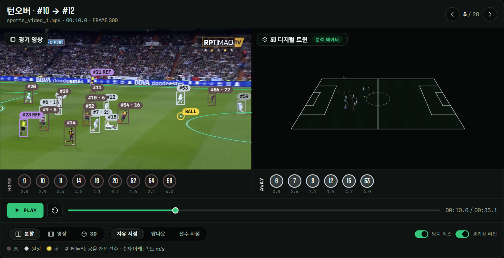

# ⚽ Soccer 3D Digital Twin

**축구 영상 기반 3D 디지털 트윈 분석 플랫폼**

축구 경기 영상에서 선수와 공을 탐지·추적하고, 경기장 좌표로 변환해 3D 디지털 트윈으로 재현합니다. 웹에서 경기 영상과 3D 트윈을 같은 타임라인으로 보며 자유로운 시점에서 경기를 분석할 수 있습니다.

**[최종 보고서 PDF](./docs/final-report/InhaSportsTracking-final-report.pdf)** · [화면 캡처](./docs/final-report/screenshots) · [GPU 측정 결과](./docs/final-report/evidence/sam_batch.md) · [기술 명세](./docs/PROJECT_OVERVIEW.md)



---

## 🎯 프로젝트 개요

### 핵심 기술 스택

- **Object Detection**: 축구 데이터로 파인튜닝한 RF-DETR (GPU) · YOLO11 (CPU)
- **GPU 정밀 모델**: SAM3 마스크·영상 추적 · SigLIP2 팀 분류 · GLM-OCR 등번호 인식 · Qwen3-VL 경기 질의 에이전트 — [6부 문서](./docs/PROJECT_OVERVIEW_6_GPU_MODELS.md)
- **Tracking**: BoT-SORT + 카메라 움직임 보정 (boxmot), 공 전용 BallTracker
- **Camera Motion / Calibration**: 광류 기반 프레임 간 호모그래피 + 키프레임 경기장 보정 전파
- **Coordinate Mapping**: Homography (픽셀 → 경기장 미터 좌표)
- **Backend**: FastAPI + WebSocket (30 FPS 트래킹 스트림)
- **Frontend**: React 19 + Vite + Three.js (React Three Fiber)
- **3D Gaussian Splatting**: 표준 공간 · 변형 MLP 모듈 (렌더링 연동 예정)

### 주요 기능

1. **업로드 영상 분석**: 선수·공 탐지 → 관중 제거 → 추적(공은 항상 ID 0) → 유니폼 색 팀 분류 → 카메라 움직임 추정 (백그라운드 작업, 진행률 표시)
2. **탐지 박스 오버레이**: 경기 영상 위에 어떤 선수(`#ID`, 팀 색)와 공(`BALL`)을 인식했는지 프레임 단위로 표시
3. **경기장 보정**: **자동 보정**(기준점 입력 없이 경기장 라인·센터서클로 키프레임 검출 — [5부 문서](./docs/PROJECT_OVERVIEW_5_AUTO_CALIBRATION.md)) 또는 한 프레임에서 기준점 4 개 이상 직접 지정 → 카메라 팬·줌을 따라 전 프레임에 전파
4. **3D 디지털 트윈 연동**: 분석·보정된 선수·공 위치를 영상과 같은 프레임으로 3D 재현 (자유 시점 / 탑다운 / 선수 시점)
5. **경기 통계**: 팀별 점유율과 선수별 이동 거리·최고 속력·스프린트, 패스·턴오버 이벤트
6. **고정밀 분석 모드 (기본)**: 매 프레임 탐지 + 공 타일 탐지, 끊긴 트랙 잇기·가려진 구간 보간, **경기장 라인 정렬로 보정 누적 오차 제거**, 경기장 좌표의 위치 점프 탐지와 칼만·RTS 평활화, 골키퍼 판정, 경기 지표(거리·스프린트·점유율·패스·대형·히트맵) — [4부 문서](./docs/PROJECT_OVERVIEW_4_PRECISE_ANALYSIS.md)
7. **GPU 정밀 분석**: RF-DETR 탐지, SAM3 마스크로 발 위치 정밀화, SAM3 위험 구간 묶음 추적, SigLIP2 팀 분류, GLM-OCR 등번호 판독과 트랙 재연결
8. **경기 질의 (VLM)**: "가장 많이 뛴 선수는?" 같은 질문에 로컬 Qwen3-VL 이 분석 데이터·영상 프레임을 도구로 조회해 답하고, 근거 시점을 누르면 그 장면으로 이동 — [6부 문서](./docs/PROJECT_OVERVIEW_6_GPU_MODELS.md)

---

## GPU 검증 결과

RTX 5070 12GB에서 `sports_video_1.mp4`의 전체 1,054프레임(30 fps, 35.13초)을 정밀 모드로 두 번 분석했습니다.

| 지표 | SAM3 사건별 처리 | SAM3 묶음 처리 |
|---|---:|---:|
| 전체 분석 및 자동 보정 | 741.8초 | 709.1초 |
| SAM3 영상 추적 | 222.3초 | 197.7초 |
| 최대 GPU 메모리 할당량 | 5.02 GiB | 6.72 GiB |

묶음 처리에서 전체 시간이 **4.4%** 줄었습니다. 두 실행의 프레임별 박스와 경기장 좌표는 모두 일치했습니다. 이전 이상값이 기록된 저장본에 위치 점프 처리를 적용했을 때는 최고 속력이 **12.31 → 9.44 m/s**로 내려갔고 스프린트 11회가 유지됐습니다.

통합 `pytest` 149개와 프런트엔드 빌드가 통과했습니다. 브라우저에서 홈 패스 4회와 원정 패스 3회를 확인했고, 양 팀의 패스 연결선을 눌러 해당 장면으로 이동했습니다. 성능 수치는 영상 한 편을 설정별로 한 번씩 실행한 결과입니다. Qwen3-VL 응답 시간과 정확도는 이번 검증 범위에 포함되지 않았습니다.

---

## 📁 프로젝트 구조

```
InhaSportsTracking/                 ← 모든 명령은 여기(저장소 루트)에서 실행
├── backend/
│   └── server.py                   # FastAPI: 업로드·영상 제공·분석 작업·보정·경기 지표 API, WebSocket
├── pipeline/                       # 영상 분석
│   ├── video_analysis.py           # 분석 작업(탐지·추적·카메라 움직임·팀), 보정 전파·저장
│   ├── pitch.py                    # 경기장 라인 모델·라인 검출·라인 정렬 보정
│   ├── autocalib.py                # 자동 초기 보정 (기준점 입력 없이)
│   ├── team_embed.py               # SigLIP2 + UMAP + K-Means 팀 분류
│   ├── postprocess.py              # 트랙 잇기·보간·공 정리·좌표 평활화·골키퍼
│   ├── synthetic.py                # 정답이 있는 합성 중계 영상 (테스트·벤치마크)
│   └── main_pipeline.py            # 설정 기반 파이프라인, 분석 모드 프로필, CLI
├── tracking/                       # 탐지·추적·좌표 변환
│   ├── detector.py                 # YOLO 탐지(Detection), 공 타일 추론, 모델 경로 해석
│   ├── tracker.py                  # BoT-SORT/ByteTrack/Simple, BallTracker, SoccerTracker
│   ├── rfdetr_detector.py          # RF-DETR 탐지 백엔드 (GPU)
│   ├── sam_refiner.py              # SAM3/SAM2.1 박스 프롬프트 마스크 → 발 위치
│   ├── homography.py
│   └── coordinate_mapper.py
├── agent/                          # 경기 질의 에이전트 (Qwen3-VL, 도구 8 개, OpenAI 호환 서버 전환)
├── analysis/
│   └── stats.py                    # 경기 지표 (거리·스프린트·점유율·패스·대형·히트맵)
├── gs_model/                       # 3D Gaussian Splatting 모듈 (렌더링 미연동)
├── frontend/                       # 웹 화면 (React + Vite + Three.js)
├── configs/
│   ├── model_config.yaml           # 모델·분석 모드·추적 설정
│   └── field_dimensions.yaml       # 경기장 규격
├── models/                         # YOLO11 가중치 (yolo11n.pt, yolo11s.pt)
├── scripts/                        # 실행용 스크립트
│   ├── train_rfdetr.py             # RF-DETR 축구 데이터셋 파인튜닝
│   ├── benchmark_precise.py        # 분석 모드·자동 보정 정량 비교
│   ├── diagnose_speed.py           # 속력 이상값 진단 및 처리 전후 재계산
│   ├── eval_suite.py               # 실영상 분석·보정·처리 시간 측정
│   ├── setup_roboflow.py           # Roboflow 데이터셋 다운로드
│   ├── download_roboflow_datasets.py
│   ├── test_roboflow_integration.py
│   └── sample_test.py              # 모듈 점검 + 샘플 영상 생성
├── tests/                          # 단위·통합 테스트
├── docs/
│   ├── PROJECT_OVERVIEW*.md        # 기술·기능 명세 1~13부
│   ├── final-report/               # 최종 보고서, 화면 캡처, 검증 데이터
│   └── guides/                     # 설치·실행, 모델, Roboflow, 테스트, 프론트엔드 가이드
├── data/raw/                       # 샘플 영상
├── data/samples/                   # 분석 완료 기본 샘플 (영상 10 MB + 분석 결과) — 서버 시작 시 uploads 로 복사
├── uploads/                        # 업로드 영상·분석 결과 (git 제외, 서버가 자동 생성)
├── .env.example                    # Roboflow API 키 템플릿 (.env 로 복사, git 제외)
└── requirements.txt
```

---

## 🚀 빠른 시작

> 자세한 설치(가상환경·CPU 전용 PyTorch 등)와 문제 해결은 **[설치 · 서버 실행 가이드](./docs/guides/SETUP.md)**.

### 1. 설치

```bash
pip install -r requirements.txt     # 저장소 루트에서 (가상환경 권장)
cd frontend && npm install && cd ..
```

### 2. 서버 실행 (터미널 두 개)

```bash
# 백엔드 → http://localhost:8000  (저장소 루트에서)
python -m uvicorn backend.server:app --port 8000

# 프론트엔드 → http://localhost:5173
cd frontend
npm run dev
```

브라우저에서 `http://localhost:5173` 에 접속합니다.

> 처음 실행하면 저장소에 포함된 **분석 완료 샘플**(`data/samples/` — 레알 마드리드–바르셀로나 중계 35 초, RF-DETR·SAM3·SigLIP2 고정밀 분석 결과)이 `uploads/` 로 복사되고, 첫 화면에서 바로 열립니다. 다시 분석하지 않아도 탐지 박스·3D 트윈·경기 지표·경기 질의를 볼 수 있습니다. 영상은 같은 1080p·1,054 프레임을 유지한 채 H.264 로 다시 압축했습니다(92 MB → 10 MB). `uploads/` 에 같은 이름의 파일이 이미 있으면 덮어쓰지 않으며, `SOCCER_SEED_SAMPLES=0` 이면 복사하지 않습니다.

### 3. 사용

1. 라이브러리에서 **업로드**로 경기 영상을 올리고 선택합니다.
2. **영상 분석** 카드에서 모드(**고정밀** / 빠른 미리보기)를 고르고 **분석 시작** — 진행 중에는 취소할 수 있습니다.
3. **경기장 보정** — 고정밀 분석은 끝나면 **자동으로 보정**합니다. 빠른 미리보기 결과는 **자동 보정** 버튼을 누르세요. 자동 보정이 안 되는 구간은 **기준점 직접 지정**: 오른쪽 도면에서 기준점(코너, 페널티박스 모서리, 센터서클과 하프라인 교점 등)을 고르고 영상에서 같은 지점을 클릭합니다 (한 직선 위에 있지 않은 4 점 이상).
4. 탐지 박스·3D 트윈·**경기 지표**(점유율·거리·스프린트·패스, 이벤트 클릭 시 해당 장면으로 이동)가 영상과 같은 타임라인으로 재생됩니다. **보정된 경기장 라인 표시**로 보정 정확도를 눈으로 확인할 수 있습니다.

> `detection.device: auto`는 CUDA를 사용할 수 있으면 GPU를 선택합니다. 정밀 모델 설정은 [GPU 설치·설정](./docs/PROJECT_OVERVIEW_6_GPU_MODELS.md#50-설치--설정), 파인튜닝 가중치 준비는 [RF-DETR 문서](./docs/PROJECT_OVERVIEW_8_RFDETR_FINETUNE.md)를 참고하세요.

> 브라우저가 재생할 수 있는 **H.264(MP4)** 또는 **VP9/AV1(WebM)** 영상을 사용하세요: `ffmpeg -i input.mp4 -c:v libx264 -c:a aac -movflags +faststart output.mp4`

### 4. 테스트

```bash
python -m pytest tests -q            # 저장소 루트에서
```

테스트는 합성 영상과 가짜 탐지기를 사용합니다. 위 GPU 실측은 별도로 `scripts/eval_suite.py`로 실행했습니다.

```bash
# 실시간 vs 고정밀 모드 정량 비교 (정답이 있는 합성 중계 영상)
python scripts/benchmark_precise.py --frames 300
```

---

## 📊 사용된 데이터셋

### Roboflow 전문 모델

1. **[Football Players Detection](https://universe.roboflow.com/roboflow-jvuqo/football-players-detection-3zvbc)** — 선수, 심판, 골키퍼 탐지
2. **[Football Ball Detection](https://universe.roboflow.com/roboflow-jvuqo/football-ball-detection-rejhg)** — 축구공 탐지
3. **[Football Field Detection](https://universe.roboflow.com/roboflow-jvuqo/football-field-detection-f07vi)** — 경기장 라인·영역 탐지 (캘리브레이션용)

### 기본 모델 (COCO)

- **YOLO11s / YOLO11n**: 80 클래스 일반 객체 탐지 — person (Class 0), sports ball (Class 32)
- Roboflow 모델이 없으면 자동으로 대체 사용됩니다 (COCO 모델은 `person`·`sports ball` 클래스만 추론). 작은 공 탐지 정확도가 필요하면 Roboflow 모델 학습을 권장합니다 — [모델 가이드](./docs/guides/MODELS.md)

---

## 🔧 설정 가이드

### `.env` 파일 (선택 — Roboflow 모델을 쓸 때만)

```bash
cp .env.example .env                 # Windows: copy .env.example .env
# .env 에 ROBOFLOW_API_KEY=발급받은_키 입력 → python scripts/setup_roboflow.py
```

`.env` 는 git 에 올라가지 않습니다. 자세한 내용: [Roboflow 가이드](./docs/guides/ROBOFLOW.md)

### `configs/model_config.yaml`

```yaml
detection:
  model_path: "models/yolo11n.pt"   # CPU 기본값, GPU 에서는 yolo11s 권장
  use_roboflow_models: false   # true 면 roboflow_models 경로의 전문 모델 사용
  roboflow_models:
    players: "data/roboflow_datasets/football-players-detection-3zvbc/weights/best.pt"
    ball: "data/roboflow_datasets/football-ball-detection-rejhg/weights/best.pt"
  confidence_threshold: 0.25
  device: auto                 # auto | cpu | cuda

analysis:
  mode: precise                # 기본 분석 모드 (API ?mode=realtime|precise 로 영상별 선택)
  profiles:
    realtime: {stride: 3, img_size: 640, ball_imgsz: 960, ball_tile: null, postprocess: false, line_refine: false}
    precise:  {stride: 1, img_size: 960, ball_imgsz: 1280, ball_tile: 640, postprocess: true, line_refine: true}

tracking:
  type: "botsort"              # botsort(카메라 움직임 보정, 권장) | bytetrack | simple
  track_threshold: 0.3
  match_threshold: 0.8         # 매칭 비용(1 - IoU) 상한
  max_age: 30

speed_filter:
  enabled: true                # 경기장 좌표에서 비정상 위치 점프 처리

perf:
  sam_video:
    batch: true                # 겹치는 위험 구간의 SAM3 영상 특징 재사용
```

---

## 📈 아키텍처

```
업로드 영상 ──▶ RF-DETR 또는 YOLO11 ──▶ BoT-SORT + BallTracker ──▶ 팀 분류 및 등번호 연결
     │                                                │
     └──▶ 광류 카메라 움직임 (프레임 간 호모그래피) ──┤
                                                      ▼
                                   uploads/analysis/{영상}.json
                                                      │
     경기장 보정 (자동: 라인·센터서클 / 수동: 기준점 4+) ──▶ 키프레임 × 카메라 움직임 + 라인 정렬 ──▶ 프레임별 경기장 좌표
                                                      │
                                                      ▼
            Web: 경기 영상 + 탐지 박스 오버레이  ⇄  3D 디지털 트윈 · 통계  (영상 프레임 단위 동기화)
```

---

## 🎨 Web 프론트엔드 기능

### 화면 구성

- **분할 / 경기 영상 / 3D 트윈** 레이아웃 전환
- **경기 영상 플레이어**: 업로드, 라이브러리 선택, 재생 불가 코덱 안내
- **영상 ↔ 3D 동기화**: 재생·정지·탐색 시 3D 트윈이 같은 프레임을 따라가며, 어긋나면 자동 재동기화

### 3D 카메라 시점

1. **자유 시점**: 궤도 회전·줌
2. **탑다운**: 전술 분석용 평면 뷰
3. **선수 시점**: 선수 위치에서 공을 바라보는 1인칭 시점

### 통계 패널

- **경기 지표**에서 점유율·이동 거리·스프린트·패스를 비교합니다.
- **경기 분석**에서 팀 히트맵, 패스 네트워크, 팀 대형을 봅니다. 패스 연결선을 누르면 해당 장면으로 이동하며, 팀 대형의 시계열을 영상 시점과 함께 확인할 수 있습니다.

---

## 📝 문서

**기술·기능 명세** (`docs/`)

- **[docs/PROJECT_OVERVIEW.md](./docs/PROJECT_OVERVIEW.md)**: 사용 기술·구현 기능·API·로드맵 상세 명세 (1부)
- **[docs/PROJECT_OVERVIEW_2_VIDEO_ANALYSIS.md](./docs/PROJECT_OVERVIEW_2_VIDEO_ANALYSIS.md)**: 영상 분석·경기장 보정·3D 트윈 연동 기술 상세와 실측 결과 (2부)
- **[docs/PROJECT_OVERVIEW_3_VLM.md](./docs/PROJECT_OVERVIEW_3_VLM.md)**: 컴퓨터 비전 고도화(RF-DETR·SAM3·SigLIP2·GLM-OCR)와 로컬 VLM 분석 층 조사·설계 (3부)
- **[docs/PROJECT_OVERVIEW_4_PRECISE_ANALYSIS.md](./docs/PROJECT_OVERVIEW_4_PRECISE_ANALYSIS.md)**: 고정밀 분석 모드 — 라인 정렬 보정·오프라인 후처리·경기 지표 구현과 정량 비교 (4부)
- **[docs/PROJECT_OVERVIEW_5_AUTO_CALIBRATION.md](./docs/PROJECT_OVERVIEW_5_AUTO_CALIBRATION.md)**: 자동 초기 보정 — 기준점 입력 없이 경기장 라인·센터서클 기하로 보정 (5부)
- **[docs/PROJECT_OVERVIEW_6_GPU_MODELS.md](./docs/PROJECT_OVERVIEW_6_GPU_MODELS.md)**: GPU 정밀 모델 — RF-DETR · SAM3 · SigLIP2 · Qwen3-VL 질의 에이전트 구현과 실측 (6부)

- [움직이는 카메라의 경기장 보정](./docs/PROJECT_OVERVIEW_7_PITCH_CALIBRATION.md)
- [RF-DETR 축구 데이터 파인튜닝](./docs/PROJECT_OVERVIEW_8_RFDETR_FINETUNE.md) · [GLM-OCR 등번호 인식](./docs/PROJECT_OVERVIEW_9_JERSEY_OCR.md) · [SAM3 영상 추적](./docs/PROJECT_OVERVIEW_10_SAM3_VIDEO.md)
- [선수 속력 이상값 처리](./docs/PROJECT_OVERVIEW_11_SPEED_OUTLIERS.md) · [처리 시간 단축 및 측정](./docs/PROJECT_OVERVIEW_12_PERFORMANCE.md) · [경기 분석 화면](./docs/PROJECT_OVERVIEW_13_ANALYSIS_VIEWS.md)

**가이드** (`docs/guides/`)

- **[SETUP.md](./docs/guides/SETUP.md)**: 설치 · 서버 실행 · 실행 중 생기는 폴더 · 문제 해결
- **[MODELS.md](./docs/guides/MODELS.md)**: 탐지 모델 · 설정 · 코드에서 사용
- **[ROBOFLOW.md](./docs/guides/ROBOFLOW.md)**: Roboflow 축구 전용 데이터셋 다운로드 · 학습 · 적용
- **[TESTING.md](./docs/guides/TESTING.md)**: 테스트 · 벤치마크 · 점검 스크립트
- **[FRONTEND.md](./docs/guides/FRONTEND.md)**: 웹 화면 구성 · 기능

---

## 🚧 개발 현황

- ✅ YOLO11 모델 통합 · Roboflow 데이터셋 연동
- ✅ 객체 탐지 및 추적 (BoT-SORT 카메라 움직임 보정, 공 단일 ID)
- ✅ 업로드 영상 분석 작업 · 탐지 박스 오버레이 · 팀 자동 분류
- ✅ 경기장 보정 (키프레임 + 카메라 움직임 전파) → 3D 트윈 연동
- ✅ FastAPI 백엔드 · 영상 업로드/제공 · Web 프론트엔드
- ✅ 고정밀 분석 모드 — 경기장 라인 정렬 보정, 트랙 잇기·보간, 좌표 평활화, 골키퍼 판정
- ✅ 경기 지표 — 이동 거리·스프린트·점유율·패스/턴오버·팀 대형·히트맵 (`/analysis/{영상}/stats`)
- ✅ 자동 경기장 보정 — 기준점 입력 없이 라인·센터서클 기하로 키프레임 검출, 교차 검증 (`/analysis/{영상}/calibration/auto`)
- ✅ GPU 정밀 모델 — RF-DETR 탐지 · SAM3 발 위치 · SigLIP2 팀 분류 (`auto`: GPU 일 때만)
- ✅ 경기 질의 에이전트 — 로컬 Qwen3-VL + 도구 8 개, 웹 질의 패널 (`/analysis/{영상}/ask`)
- ✅ RF-DETR 축구 데이터 파인튜닝 · SAM3 영상 추적으로 트랙 끊김·ID 교체 보정 · GLM-OCR 등번호 판독
- ✅ 속력 이상값 처리 · SAM3 구간 묶음 처리 · 팀 히트맵·패스 네트워크·팀 대형 화면
- ✅ 단위·통합 테스트 149개 · 프런트엔드 빌드 · 샘플 영상 전체 GPU 검증
- 🔶 3D Gaussian Splatting — 표준 공간·변형 MLP 모듈만 구현, 렌더링 미연동
- ⏳ 경기장 키포인트 모델 · 여러 경기에서의 정확도 및 처리 시간 검증
- ⏳ SMPL 포즈 복원

자세한 로드맵은 [향후 구현 계획](./docs/PROJECT_OVERVIEW.md#6-향후-구현-계획)을 참고하세요.

---

## 📚 참고 자료

- [Roboflow Sports](https://github.com/roboflow/sports)
- [Ultralytics YOLO11](https://docs.ultralytics.com/models/yolo11/)
- [boxmot](https://github.com/mikel-brostrom/boxmot)
- [FastAPI](https://fastapi.tiangolo.com/)
- [Three.js 문서](https://threejs.org/docs/) · [React Three Fiber](https://r3f.docs.pmnd.rs/)
- [Deformable 3DGS](https://arxiv.org/abs/2312.00106)
- [Material Design – Dark theme](https://m2.material.io/design/color/dark-theme.html)
- [Pretendard](https://github.com/orioncactus/pretendard)

---

## 👥 기여

이슈 및 PR 환영합니다!

---

## 📄 라이선스

MIT License
